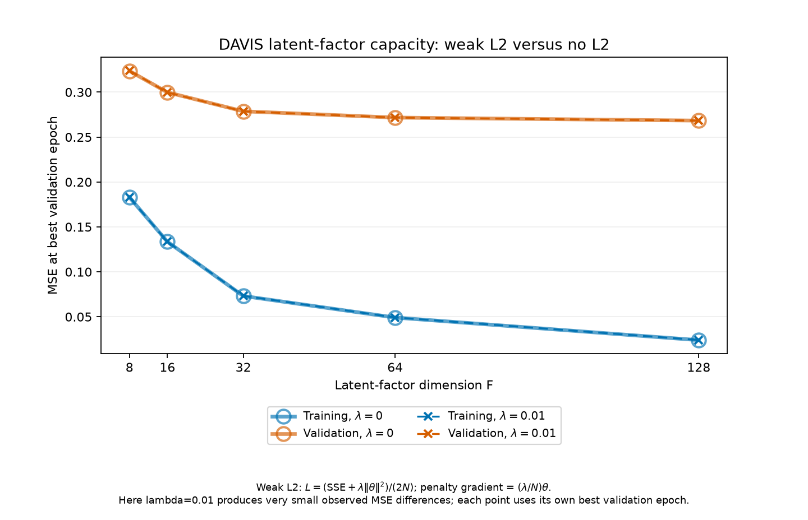
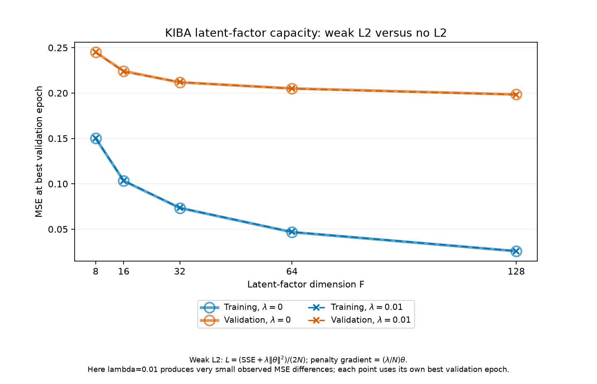
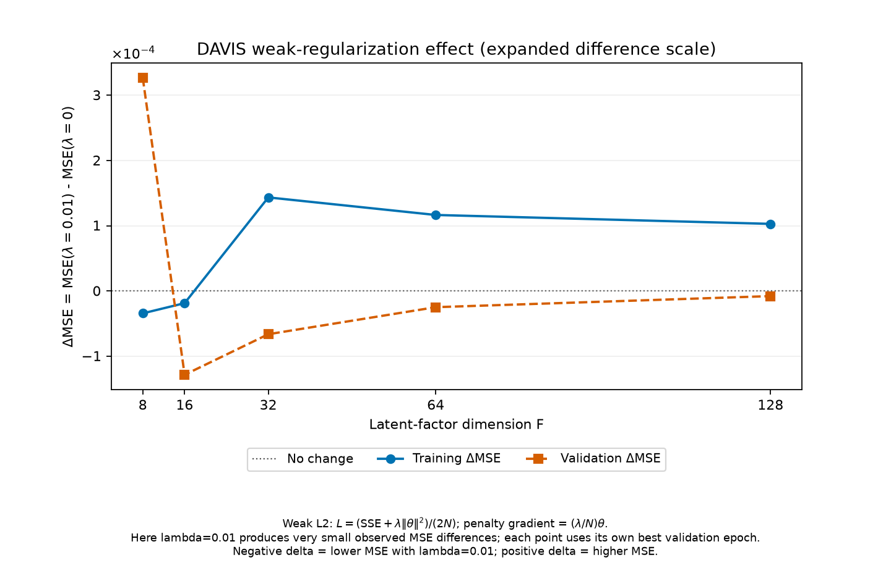
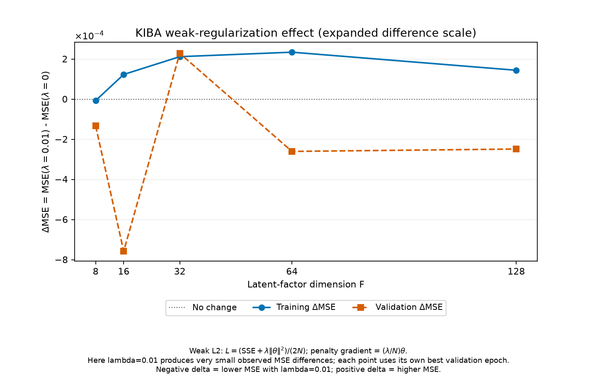

# Biased MF: capacity, regularization and validation generalization

> **Published notebook and final models:** the [executed notebook](../../biased_mf.ipynb)
> embeds the recorded tables, all 73 learning traces and explanations, including
> the combined comparison with Jiaxin. The two final checkpoints are published
> under `task2/saved_models/`. The four Stage 1 capacity/delta PNGs are also
> published. Other separate CSV/image/log files and intermediate checkpoints
> remain local; paths to them below identify local/generated evidence.
> Rerunning the notebook needs no external result CSVs or images and does not
> train. No full campaign was rerun for publication.

> **Consolidated official workflow.** The scientific results below are unchanged
> from the completed 73-fit campaign. Operational paths now use
> `task2/run_biased_mf.py`, `task2/biased_mf.ipynb`, `task2/results/biased_mf/`
> and `task2/saved_models/`. Intermediate states were archived locally after
> verification; compact metrics, all epoch histories, figures and original
> source/data provenance remain. See `RETENTION.md`.

## Executive summary

**Research question:** How do latent-factor dimension and L2 regularization
influence prediction accuracy, overfitting and generalization of Biased Matrix
Factorization on DAVIS and KIBA?

The completed investigation consists of a capacity study, learning-curve
analysis, a joint F–lambda grid, learning-rate refinement and three-seed
assessment. It used the existing observed-only model and fixed train/validation
splits, with no final-test data. Results did not always follow the simplest
capacity/overfitting narrative:

1. Increasing F through 128 improved best-validation MSE in the capacity study,
   even while train–validation gaps grew and validation minima occurred earlier.
2. Moderate L2 usually helped, but its preferred strength depended on F in DAVIS.
   In KIBA, the preferred F changed under strong regularization.
3. Learning rate affected both speed and the attained validation solution.
   Lower rates needed more updates but gave better validation MSE in the refined
   families; one family needed the predefined epoch extension.
4. Both datasets ultimately selected **F=128, lambda=1, alpha=0.001** by the
   lowest three-seed mean validation MSE among two frozen shortlisted configurations.
   The handoff model is **always seed 42**, not whichever seed looked best.

### Validation-selected handoff models

| Dataset | F | Lambda | Alpha | Seed | Training MSE | Validation MSE | Global CI | Hit@1 | Hit@5 | Best / stop epoch |
|---|---:|---:|---:|---:|---:|---:|---:|---:|---:|---|
| DAVIS | 128 | 1 | 0.001 | 42 | 0.026219 | **0.259842** | 0.873175 | 0.338235 | 0.720588 | 74 / 84 |
| KIBA | 128 | 1 | 0.001 | 42 | 0.023247 | **0.188761** | 0.848053 | 0.690391 | 0.952211 | 34 / 44 |

Three-seed validation MSE, **mean ± sample standard deviation**:

- DAVIS: **0.258847 ± 0.002471**.
- KIBA: **0.189855 ± 0.001323**.

Both final checkpoints are published under [task2/saved_models/](../../saved_models/),
and reloads reproduce the saved training and validation predictions exactly.
These are validation-selected results, **not final test performance**.

## 1. Scope, data and numerical contract

The official [`../../run_biased_mf.py`](../../run_biased_mf.py) contains the
campaign and its split/evaluation orchestration helpers. It imports the
byte-unchanged [`../../utils/biased_mf.py`](../../utils/biased_mf.py) and shared
[`../../utils/evaluation.py`](../../utils/evaluation.py). The moved helper
functions have identical AST hashes to their pre-consolidation versions.
No teammate models or shared datasets were modified. Old MF working copies
were retired only after archiving their evidence and verifying promoted models.

Prediction and objective remain:

$$
\hat y_{ij}=\mu+b_i+c_j+p_i^\top q_j,
\qquad
L=\frac{\sum_{(i,j)\in\Omega_{\rm train}}(\hat y_{ij}-y_{ij})^2+
\lambda(\|b\|^2+\|c\|^2+\|P\|_F^2+\|Q\|_F^2)}{2N}.
$$

The mean and mappings are training-only. Mini-batch gradients use the batch
mean data gradient plus **lambda/N times every parameter**, including rows not
observed in that batch. No changes were made to repeated-index accumulation,
Adam moments/bias correction, label scale, clipping policy or early stopping.
Adam uses beta1=0.9, beta2=0.999 and epsilon=1e-8. Validation labels are only
used for epoch/configuration selection and evaluation, not gradient updates.

| Dataset | Training rows | Validation rows | Training drugs | Training targets | Validation drugs / targets |
|---|---:|---:|---:|---:|---|
| DAVIS | 18,040 | 3,865 | 68 | 379 | 68 / 379 |
| KIBA | 82,359 | 17,648 | 2,068 | 229 | 1,967 / 228 |

Train/validation pair disjointness, pair uniqueness, finite labels, nonblank
identifiers and validation-ID coverage passed. Exact file hashes are stored in
`data_integrity.csv` and `manifest.json`.
The final-test files were not opened, even for rechecking integrity; only
train/validation integrity was newly verified. DAVIS remains on supplied pKd;
KIBA remains on the supplied transformed KIBA scale. Missing pairs are not zeros.

All experiments use batch size **2048**, patience **10**, and fixed training
and validation partitions. The initial cap is **100 epochs**. Epoch zero is
evaluated and eligible; parameters are restored to the strictly best validation
epoch. Tie-breaking between configurations is deterministic: smaller F, then
lambda, then alpha after the primary validation-MSE criterion.

MSE averages over observations. CI is global over all validation observations,
excluding equal actual scores and assigning half credit to tied predictions.
Hit@K is macro-averaged over ligands' measured validation candidates, with
prediction ties broken by target string and all tied actual best targets eligible.
The same definitions are used for all stages and historical comparisons.

## 2. Prospective design, provenance and reuse

The [PROTOCOL.md](PROTOCOL.md), configuration plan and reuse audit were written
before the campaign fits. Key decisions were fixed in advance:

| Stage | Research question | Varied | Held constant | Evaluated conditions |
|---|---|---|---|---:|
| 1: capacity | Does higher F improve fit and validation accuracy? | F=8,16,32,64,128; lambda=0 or 0.01 | alpha=0.005, seed=42, cap=100 | 20 across both datasets |
| 2: curves | Does further training after the minimum worsen held-out accuracy? | No new fits | Stage 1 trajectories | 20 trajectories |
| 3: interaction | Does the best penalty depend on F, and vice versa? | F crossed with lambda=0,0.01,0.1,1,10 | alpha=0.005, seed=42, cap=100 | 50, including Stage 1 |
| 4: rate | Does alpha change convergence and validation performance? | alpha=0.001,0.003,0.005,0.01 | Two F–lambda pairs per dataset; seed=42 | 16, including four Stage 3 runs |
| 5: seeds | Are the shortlisted results stable across initialization/shuffling? | seeds=42,123,2026 | Two frozen full configurations per dataset | 12, including four Stage 4 runs |

Only validation MSE advances candidates. Neither training MSE, gap size, CI nor
Hit@K selects configurations. Unregularized runs are comparisons in the joint
study, not an instruction to choose the largest F or a particular final model.

### Historical audit and the reason for reruns

The original 32-grid results, baseline, selected checkpoints, regularization
sweep and histories were inspected. Their settings, score scales and available
checkpoint mappings/means/metrics were consistent. However:

- No historical artifact embedded the model-source and dataset hashes needed
  to establish the requested code/data provenance.
- Most historical configurations had metrics/history but no saved parameters.
- The regularization sweep explicitly saved no new checkpoints.

Consequently, historical states were **not silently adopted as campaign fits**.
The 14 matching historical configurations required by the core study were
rerun and marked `historical_unverified_rerun`. Their metrics reproduced within
`rtol=atol=1e-12`. The two available selected F=64/lambda=0.01 checkpoints also
matched the rerun **parameters, mappings, mean and complete histories exactly**.
This confirms numerical reproduction under the now-fingerprinted environment;
it does not manufacture missing historical source hashes.

The complete historical audit is in
`historical_reuse_audit.csv`. Historical lambda=100
results were copied as labeled supplementary evidence, not used to fit or
select campaign models: `historical_lambda100_supplement.csv`.

The original starting DAVIS baseline is also preserved numerically in
`provenance/historical_results.csv`: F=16,
alpha=0.01, lambda=0.001, best epoch 15, stop epoch 25, training MSE
0.1142141808, validation MSE 0.3024631209, CI 0.8547975554, Hit@1
0.3235294118 and Hit@5 0.6029411765. Its validation MSE decreased from
0.675128 to the epoch-15 minimum and then rose to 0.329505, motivating
early-stopping review before the earlier grid. Its old standalone notebook,
curve, history and checkpoint remain in the local backup rather than the
official workflow. All 32 original-grid and eight added-sweep conditions are
retained in the compact historical table; their useful findings were not lost.

### Safe reuse within this campaign

During execution, each fit saved its complete prediction state, source/data fingerprints, metrics,
history and separate train/validation prediction arrays. Before reuse, the runner
checks configuration, hashes, mappings, mean, saved prediction equality and
recomputed metrics. A mismatched state is rejected. Completed run directories
are reused read-only; stage CSVs and selected checkpoint paths refuse overwrites.

The retained local compact evidence no longer includes the intermediate run directories.
Their numerical results, complete histories and hashes remain in aggregate tables.
The official read-only verifier checks these tables and the two final checkpoint
prediction hashes without requesting or reconstructing intermediate checkpoints.

Stage 3 reused all 20 capacity fits. Stage 4 reused four joint-grid fits.
Stage 5 reused four seed-42 fits (and the applicable extension state). The DAVIS
F=8/lambda=0.01 smoke check also became a capacity result rather than an extra fit.

### Actual computational accounting

| Work | Physical fits |
|---|---:|
| Capacity, including the smoke-check fit | 20 |
| Additional interaction-grid conditions | 30 |
| Additional learning-rate conditions | 12 |
| Learning-rate cap extension | 1 |
| Additional random seeds | 8 |
| Random-seed cap extensions | 2 |
| **Total** | **73** |

There are **70 unique base dataset/F/lambda/alpha/seed conditions**: 14 historical
repetitions and 56 previously untested conditions. Three additional fits replay
and extend a 100-epoch condition to a 300-epoch cap. All 73 completed with finite
metrics; there were **zero numerical failures**. The recorded fit-only time sums
to approximately **503 seconds**; this excludes substantial verification,
checkpoint I/O, plotting and reporting time. The inventory contains **61,298
actual optimizer updates** across physical fits and **3,275 history rows**,
including epoch-zero records and extension-prefix replay.

## 3. Stage 1: latent-factor capacity

**Hypothesis:** more latent factors permit a better training fit, but may
overfit earlier; best-validation performance need not improve indefinitely.

The number of learned scalars is $(D+T)(F+1)$: drug and target factors plus both
bias vectors. The fixed mean is excluded.

| F | DAVIS parameters | KIBA parameters |
|---:|---:|---:|
| 8 | 4,023 | 20,673 |
| 16 | 7,599 | 39,049 |
| 32 | 14,751 | 75,801 |
| 64 | 29,055 | 149,305 |
| 128 | 57,663 | 296,313 |

These are nominal parameter counts, not independently identifiable degrees of
freedom. In particular, DAVIS has only 68 drug rows: the interaction matrix rank
cannot exceed 68 even with F=128. Beyond F=64, optimization, redundant
parameterization and regularization also matter; “twice the factors” does not
mean twice the realizable matrix rank. The number of learned scalars exceeds
the number of training observations at the larger ranks.

### Capacity results, restored best epochs

| Dataset | F | Lambda | Training MSE | Validation MSE | Best epoch | Stop epoch |
|---|---:|---:|---:|---:|---:|---:|
| DAVIS | 8 | 0 | 0.182918 | 0.323579 | 30 | 40 |
| DAVIS | 8 | 0.01 | 0.182884 | 0.323905 | 30 | 40 |
| DAVIS | 16 | 0 | 0.133496 | 0.299793 | 24 | 34 |
| DAVIS | 16 | 0.01 | 0.133477 | 0.299665 | 24 | 34 |
| DAVIS | 32 | 0 | 0.073101 | 0.278691 | 23 | 33 |
| DAVIS | 32 | 0.01 | 0.073244 | 0.278625 | 23 | 33 |
| DAVIS | 64 | 0 | 0.049098 | 0.271701 | 16 | 26 |
| DAVIS | 64 | 0.01 | 0.049215 | 0.271677 | 16 | 26 |
| DAVIS | 128 | 0 | 0.023977 | 0.268324 | 14 | 24 |
| DAVIS | 128 | 0.01 | 0.024080 | 0.268317 | 14 | 24 |
| KIBA | 8 | 0 | 0.150221 | 0.245044 | 13 | 23 |
| KIBA | 8 | 0.01 | 0.150214 | 0.244911 | 13 | 23 |
| KIBA | 16 | 0 | 0.103277 | 0.224235 | 12 | 22 |
| KIBA | 16 | 0.01 | 0.103400 | 0.223478 | 12 | 22 |
| KIBA | 32 | 0 | 0.073389 | 0.211829 | 9 | 19 |
| KIBA | 32 | 0.01 | 0.073601 | 0.212057 | 9 | 19 |
| KIBA | 64 | 0 | 0.046733 | 0.205091 | 7 | 17 |
| KIBA | 64 | 0.01 | 0.046967 | 0.204831 | 7 | 17 |
| KIBA | 128 | 0 | 0.025759 | 0.198461 | 6 | 16 |
| KIBA | 128 | 0.01 | 0.025903 | 0.198213 | 6 | 16 |

Full metrics, including CI, Hit@K, gaps, parameter counts and descriptive
underfitting/overfitting indicators, are in `stage1_capacity.csv`.




**Capacity-plot caption:** blue denotes training and orange denotes validation.
Lambda=0 uses broad solid lines and large open circles drawn underneath thin
dashed lines and small crosses for lambda=0.01. Both markers remain visible at
nearly coincident positions; no jitter or numerical score offsets are applied.
The weak penalty produces very small observed differences under
`L=(SSE + lambda * sum(parameter^2))/(2N)`, with gradient contribution
`lambda/N * parameter`. Near-overlap is therefore a measured result, not a
missing series.




**Difference-plot caption:** delta MSE is `MSE(lambda=0.01) - MSE(lambda=0)`
at the same factor dimension, using each run's best-validation checkpoint.
Training and validation deltas are plotted separately against F with a zero
reference line and scientific-notation y-axis. Negative means lower MSE with
weak L2; positive means higher MSE. The expanded difference scale reveals small
effects without altering labels, smoothing observations or implying significance.
The notebook also displays the paired differences numerically. The largest
absolute validation differences are about **3.27e-4 for DAVIS** and **7.57e-4
for KIBA**, much smaller than their absolute MSE levels.

These figures can be refreshed from the existing local capacity table alone:

```bash
OPENBLAS_NUM_THREADS=1 .venv/bin/python -B -m task2.run_biased_mf --stage capacity-plots
```

This plot-only route reads `stage1_capacity.csv` and writes the four capacity
PNGs; it never constructs a training campaign or calls the fitter. The notebook
uses the same plotting helper with its embedded recorded table, requiring no
external CSV to display the updated plots.

**Finding:** for both penalties and datasets, training and best-validation MSE
decrease at each tested increase in F. Thus the capacity benefit is supported,
but an inverted-U validation curve is **not** observed in this range. Lambda=0.01
does not uniformly beat zero: DAVIS F=8 and KIBA F=32 slightly favor no L2.
The weak penalty often changes results only slightly.

Larger F also changes the number of random initialization draws and the RNG
position before shuffling. A common seed makes each run reproducible but does
not hold the complete random trajectory identical across different F. The
nonconvex optimizer and early stopping mean monotonic training performance is
an observed result here, not a general guarantee.

## 4. Stage 2: overfitting from learning curves

**Hypothesis:** larger models may reach a validation optimum earlier, after
which training continues improving at the expense of held-out performance.

The operational curve flag requires both:

- final training MSE at least 1e-6 below training MSE at the selected epoch; and
- final validation MSE at least 1e-6 above the best validation MSE.

It is a descriptive numerical rule, not statistical significance or a claim
that every intermediate epoch worsens. All 20 capacity trajectories meet it.
All stopped by patience. Every returned/saved model was verified to predict
the metrics at the **best epoch**, rather than the last attempted epoch.

At lambda=0.01:

| Dataset | F | Train–validation gap at best | Best epoch | Validation MSE at best | Validation MSE at stop |
|---|---:|---:|---:|---:|---:|
| DAVIS | 8 | 0.141021 | 30 | 0.323905 | 0.325980 |
| DAVIS | 64 | 0.222462 | 16 | 0.271677 | 0.279497 |
| DAVIS | 128 | 0.244237 | 14 | 0.268317 | 0.274115 |
| KIBA | 8 | 0.094696 | 13 | 0.244911 | 0.250291 |
| KIBA | 64 | 0.157864 | 7 | 0.204831 | 0.231655 |
| KIBA | 128 | 0.172310 | 6 | 0.198213 | 0.211849 |

For DAVIS F=128, training MSE falls from 0.024080 at epoch 14 to 0.002098 at
epoch 24 while validation MSE worsens. For KIBA F=128 it falls from 0.025903
at epoch 6 to 0.002976 at epoch 16 while validation worsens. These are concrete
curve-based signs of late overfitting. The larger gaps alone would not prove it.

*Local/generated figure: `figures/davis_capacity_curves_l0.01.png` — DAVIS capacity trajectories.*
*Local/generated figure: `figures/kiba_capacity_curves_l0.01.png` — KIBA capacity trajectories.*

**Finding:** larger F reaches its validation minimum earlier in epoch units,
but also achieves lower best-validation MSE. The amount of post-minimum
deterioration is not monotonic in F. The hypothesis about earlier overfitting is
supported within these runs; a claim that larger F necessarily produces worse
selected validation accuracy is contradicted.

KIBA uses **41 optimizer batches per epoch**, versus **9** for DAVIS. Earlier
epochs across datasets do not imply fewer updates. Smaller models have higher
training and validation errors than the best peer, suggesting capacity or
optimization limitations, but they still overfit with continued training.
“Underfit” and “overfit” are therefore not mutually exclusive labels for an
entire model family at all epochs.

The stage-specific interpretation was saved before the interaction study in
`STAGE2_INTERPRETATION.md`. The complete diagnostics
are in `stage2_curve_diagnostics.csv`.

## 5. Stage 3: L2 and F–lambda interaction

**Hypothesis:** penalizing coefficient magnitudes can improve validation
generalization, but excessive shrinkage can underfit; the optimum may depend
on latent dimension and dataset.

The full joint grid crosses F={8,16,32,64,128} with lambda={0,0.01,0.1,1,10},
at alpha=0.005 and seed 42. All 25 conditions per dataset use the same 100-epoch
budget and patience. Stage 1 states were verified and reused.

### Validation MSE surfaces

| DAVIS F | Lambda 0 | Lambda 0.01 | Lambda 0.1 | Lambda 1 | Lambda 10 |
|---:|---:|---:|---:|---:|---:|
| 8 | 0.323579 | 0.323905 | 0.323780 | 0.315412 | 0.309103* |
| 16 | 0.299793 | 0.299665 | 0.298762 | 0.292319 | 0.304769* |
| 32 | 0.278691 | 0.278625 | 0.278221 | 0.270710 | 0.303615* |
| 64 | 0.271701 | 0.271677 | 0.271249 | 0.267443 | 0.302475 |
| 128 | 0.268324 | 0.268317 | 0.267810 | **0.264120** | 0.302430 |

| KIBA F | Lambda 0 | Lambda 0.01 | Lambda 0.1 | Lambda 1 | Lambda 10 |
|---:|---:|---:|---:|---:|---:|
| 8 | 0.245044 | 0.244911 | 0.241837 | 0.236101 | 0.240822* |
| 16 | 0.224235 | 0.223478 | 0.222116 | 0.218759 | 0.227906 |
| 32 | 0.211829 | 0.212057 | 0.212171 | 0.207177 | 0.223612 |
| 64 | 0.205091 | 0.204831 | 0.204227 | 0.199242 | 0.224459 |
| 128 | 0.198461 | 0.198213 | 0.197257 | **0.193851** | 0.225844 |

`*` These four core runs reached 100 epochs with a recent validation best:
DAVIS F=8,16,32/lambda=10 and KIBA F=8/lambda=10. They are flagged
`cap_still_improving`, not presented as fully converged. Their recorded best
epochs are 98,98,97 and 94. Stage 3 intentionally retains the requested fixed
100-epoch study; no unplanned extension grid was added. The Stage 4 extension
protocol applies to refinement candidates. Core comparisons involving these
cells are budget-conditional, particularly the DAVIS F=8 best-lambda statement.

*Local/generated figure: `figures/davis_interaction_heatmaps.png` — DAVIS train and validation heatmaps.*
*Local/generated figure: `figures/kiba_interaction_heatmaps.png` — KIBA train and validation heatmaps.*

The two panels use separately labeled color scales: compare the numerical
annotations, not identical colors as if training and validation shared a scale.
All displayed values are actual recorded metrics, with no smoothing.

*Local/generated figure: `figures/davis_regularization.png` — DAVIS validation versus lambda.*
*Local/generated figure: `figures/kiba_regularization.png` — KIBA validation versus lambda.*

The lambda line plots use categorical spacing to include zero; they are not
log-scaled distances or claims about interpolation between tested penalties.

### Best lambda for each F

| Dataset | F | Best lambda | Training MSE | Validation MSE | Best / stop epoch |
|---|---:|---:|---:|---:|---|
| DAVIS | 8 | 10 | 0.209456 | 0.309103 | 98 / 100 (capped) |
| DAVIS | 16 | 1 | 0.102858 | 0.292319 | 34 / 44 |
| DAVIS | 32 | 1 | 0.062952 | 0.270710 | 28 / 38 |
| DAVIS | 64 | 1 | 0.041480 | 0.267443 | 20 / 30 |
| DAVIS | 128 | 1 | 0.031364 | 0.264120 | 15 / 25 |
| KIBA | 8 | 1 | 0.134901 | 0.236101 | 22 / 32 |
| KIBA | 16 | 1 | 0.108153 | 0.218759 | 12 / 22 |
| KIBA | 32 | 1 | 0.073270 | 0.207177 | 10 / 20 |
| KIBA | 64 | 1 | 0.038660 | 0.199242 | 9 / 19 |
| KIBA | 128 | 1 | 0.036058 | 0.193851 | 6 / 16 |

### Does the preferred F change with lambda?

| Lambda | Best DAVIS F | DAVIS validation MSE | Best KIBA F | KIBA validation MSE |
|---:|---:|---:|---:|---:|
| 0 | 128 | 0.268324 | 128 | 0.198461 |
| 0.01 | 128 | 0.268317 | 128 | 0.198213 |
| 0.1 | 128 | 0.267810 | 128 | 0.197257 |
| 1 | 128 | 0.264120 | 128 | 0.193851 |
| 10 | 128 | 0.302430 | **32** | **0.223612** |

**Findings:** the preferred penalty changes with F in DAVIS, while the preferred
F changes with strong penalty in KIBA. KIBA does not show a change in its
per-F best lambda within this grid: it is 1 throughout. Thus interaction is
not asserted identically in both directions for both datasets.

At F=128, increasing lambda from 1 to 10 raises DAVIS training/validation MSE
from 0.031364/0.264120 to 0.185087/0.302430, and KIBA from
0.036058/0.193851 to 0.131350/0.225844. These higher errors and plateauing
curves are consistent with excessive shrinkage at these settings. The conclusion
does not apply universally to lambda=10: DAVIS F=8 prefers it within budget.
Similarly, KIBA F=32 deteriorates slightly from lambda=0 to 0.1 before improving
at 1. Stronger regularization is not uniformly beneficial.

*Local/generated figure: `figures/davis_regularization_curves_f128.png` — DAVIS representative regularization curves.*
*Local/generated figure: `figures/kiba_regularization_curves_f128.png` — KIBA representative regularization curves.*

Additional no/moderate/strong-penalty trajectories are provided for F=8 and F=64
in `figures/*_regularization_curves_f8.png` and `*_f64.png`. Historical F=64,
lambda=100 validation MSE was 0.487024 on DAVIS and 0.503147 on KIBA; those
unchanged earlier results are supplementary underfitting evidence, not new fits
with verified campaign provenance.

The refined pairs are the two smallest Stage 3 validation-MSE rows per dataset:
DAVIS **(128,1)** and **(64,1)**; KIBA **(128,1)** and **(128,0.1)**.
See `stage3_interaction.csv`,
`stage3_best_lambda_per_f.csv` and
`stage3_best_f_per_lambda.csv`.

## 6. Stage 4: Adam base learning rate

**Hypothesis:** even though Adam adapts its per-coordinate update scaling, the
base learning rate changes the path, speed and solution obtained with early
stopping. The four rates were predeclared; no larger rate grid was launched.

### Consistent extension protocol

Every refined condition starts with cap=100. If it reaches that cap and has a
new best validation score in the final ten epochs, it is rerun from the same
seed with cap=300 and the same patience. The original 100-epoch run remains in
the inventory; the extended result is used for comparison. The first 101 history
rows, including epoch zero, must match **exactly**. This is a deterministic
prefix replay because the fitter does not save resumable Adam/RNG state.

The same rule applies to every rate and all robustness seeds, not just a
configuration favored after seeing its result. There is no extension above 300.
Core grid cells remain a separately labeled 100-epoch experiment.

### Rate results at seed 42

`Updates` below counts the selected physical run through its stopping epoch,
including the patience tail. It is not the number of updates through the best
epoch, which is also recorded in the CSV.

| Dataset | F | Lambda | Alpha | Training MSE | Validation MSE | Best / stop epoch | Updates |
|---|---:|---:|---:|---:|---:|---|---:|
| DAVIS | 64 | 1 | 0.001 | 0.034381 | 0.259899 | 105 / 115 | 1,035 |
| DAVIS | 64 | 1 | 0.003 | 0.039635 | 0.263167 | 33 / 43 | 387 |
| DAVIS | 64 | 1 | 0.005 | 0.041480 | 0.267443 | 20 / 30 | 270 |
| DAVIS | 64 | 1 | 0.01 | 0.020445 | 0.272112 | 14 / 24 | 216 |
| DAVIS | 128 | 1 | 0.001 | 0.026219 | **0.259842** | 74 / 84 | 756 |
| DAVIS | 128 | 1 | 0.003 | 0.028465 | 0.263022 | 25 / 35 | 315 |
| DAVIS | 128 | 1 | 0.005 | 0.031364 | 0.264120 | 15 / 25 | 225 |
| DAVIS | 128 | 1 | 0.01 | 0.023185 | 0.268846 | 9 / 19 | 171 |
| KIBA | 128 | 1 | 0.001 | 0.023247 | **0.188761** | 34 / 44 | 1,804 |
| KIBA | 128 | 1 | 0.003 | 0.026268 | 0.189752 | 11 / 21 | 861 |
| KIBA | 128 | 1 | 0.005 | 0.036058 | 0.193851 | 6 / 16 | 656 |
| KIBA | 128 | 1 | 0.01 | 0.033482 | 0.203476 | 4 / 14 | 574 |
| KIBA | 128 | 0.1 | 0.001 | 0.028151 | 0.191518 | 27 / 37 | 1,517 |
| KIBA | 128 | 0.1 | 0.003 | 0.030110 | 0.193768 | 9 / 19 | 779 |
| KIBA | 128 | 0.1 | 0.005 | 0.026755 | 0.197257 | 6 / 16 | 656 |
| KIBA | 128 | 0.1 | 0.01 | 0.026098 | 0.209704 | 4 / 14 | 574 |

DAVIS F=64/lambda=1/alpha=0.001 triggered the extension: initial best epoch 100,
validation MSE 0.260110; extended best epoch 105, validation MSE 0.259899,
stop epoch 115. Its actual computational cost includes the discarded-prefix
fit: **900 + 1,035 = 1,935 updates**. Both runs are retained, so aggregate
accounting does not hide this cost.

*Local/generated figure: `figures/davis_rate_curves_candidate1.png` — DAVIS rate curves, rank 128.*
*Local/generated figure: `figures/davis_rate_curves_candidate2.png` — DAVIS rate curves, rank 64.*
*Local/generated figure: `figures/kiba_rate_curves_candidate1.png` — KIBA rate curves, lambda 1.*
*Local/generated figure: `figures/kiba_rate_curves_candidate2.png` — KIBA rate curves, lambda 0.1.*

**Findings:** alpha=0.001 gives the best validation MSE in each refined family,
but requires more updates. All refined final runs stop by patience and are
finite; no rate is labeled unstable merely because its validation MSE is worse.
The very low training MSE of DAVIS F=64/alpha=0.01 does not make it the winner.

The results support a learning-rate effect on both speed and attained
validation performance. They do not establish that all rates would converge
to a common solution with infinite training, or that Adam would outperform
SGD; no SGD comparison was run. F–lambda preferences in the core study are
conditional on alpha=0.005, and rate refinement is confined to the two selected
pairs rather than the entire three-dimensional grid.

The four frozen robustness candidates are:

- DAVIS: F=128 and F=64, both lambda=1 and alpha=0.001.
- KIBA: alpha=0.001 and 0.003, both F=128 and lambda=1.

See `stage4_plan.csv`, `stage4_candidates.csv`
and `stage4_rates.csv`. The latter retains CI, Hit@K, gaps,
best/total updates, numerical status and extension flags for every condition.

## 7. Stage 5: three-seed robustness and final selection

The top two full configurations from Stage 4 were frozen before running seeds
123 and 2026. Seed 42 was verified and reused. This separates the single-seed
screening step from the robustness measurements, while acknowledging that using
the three-seed mean to choose between shortlisted configurations is **additional
validation selection**, not independent confirmation or final testing.

The final criterion is lowest mean validation MSE across all three seeds, with
sample standard deviation (`ddof=1`) reported. The final stored seed is always
42, even if 123 or 2026 has a smaller validation MSE.

### Individual validation MSEs and epochs

| Dataset | F | Lambda | Alpha | Seed 42 MSE (best epoch) | Seed 123 MSE (best epoch) | Seed 2026 MSE (best epoch) | Mean ± sample SD |
|---|---:|---:|---:|---|---|---|---|
| DAVIS | 64 | 1 | 0.001 | 0.259899 (105) | 0.261816 (112) | 0.262165 (97) | 0.261293 ± 0.001220 |
| **DAVIS** | **128** | **1** | **0.001** | **0.259842 (74)** | **0.256034 (71)** | **0.260665 (81)** | **0.258847 ± 0.002471** |
| **KIBA** | **128** | **1** | **0.001** | **0.188761 (34)** | **0.189480 (32)** | **0.191325 (32)** | **0.189855 ± 0.001323** |
| KIBA | 128 | 1 | 0.003 | 0.189752 (11) | 0.189975 (12) | 0.192269 (11) | 0.190666 ± 0.001393 |

### Ranking metric variation across seeds

| Dataset / candidate | CI mean ± SD | Hit@1 mean ± SD | Hit@5 mean ± SD | Best epoch mean ± SD |
|---|---|---|---|---|
| DAVIS F64, alpha .001 | 0.872327 ± 0.001753 | 0.377451 ± 0.008490 | 0.740196 ± 0.008490 | 104.667 ± 7.506 |
| DAVIS F128, alpha .001 | 0.872716 ± 0.002720 | 0.372549 ± 0.037009 | 0.710784 ± 0.016981 | 75.333 ± 5.132 |
| KIBA F128, alpha .001 | 0.848538 ± 0.000423 | 0.688866 ± 0.005499 | 0.948992 ± 0.003308 | 32.667 ± 1.155 |
| KIBA F128, alpha .003 | 0.846834 ± 0.000585 | 0.679885 ± 0.001634 | 0.948483 ± 0.001634 | 11.333 ± 0.577 |

All candidates in this table use lambda=1. Complete per-seed CI/Hit@K/training
metrics are in `stage5_seed_results.csv`; means/stds
are in `stage5_robustness_summary.csv`.

*Local/generated figure: `figures/davis_seed_robustness.png` — DAVIS robustness.*
*Local/generated figure: `figures/kiba_seed_robustness.png` — KIBA robustness.*

Two additional cap extensions were triggered for DAVIS F=64/alpha=0.001:

- Seed 123: best epoch 100 at the initial cap; extended best 112, stopped 122.
- Seed 2026: best epoch 97 at the initial cap; the extension found no better
  epoch and stopped at 107, correctly retaining epoch 97.

The latter is useful negative evidence: a recent improvement at the cap does
not guarantee an extension will improve the model. All three extensions passed
exact prefix-history equality. No final refined/robustness run remains capped.

**Findings and qualifications:** DAVIS F=128 has lower MSE on each of the three
seed labels but approximately twice the sample SD of F=64, and its mean Hit@K
is lower. It is selected for the predeclared primary MSE criterion, not because
it dominates every metric. The seed-42 MSE difference is tiny; the other seeds
provide useful context. For KIBA, alpha=0.001 beats 0.003 on each observed seed
and has lower mean MSE, but the mean difference (~0.000810) is small compared
with observed variation. Three seeds are limited stability evidence, not proof
of superiority or a reliable population confidence interval. Changing F also
changes random-number consumption, so same seed labels are not exact common
random trajectories across different dimensions.

DAVIS seed 123 achieved 0.256034, better than seed 42, but **was not substituted
as the handoff model**. This avoids cherry-picking a favorable random seed.

## 8. Comparison with earlier selected references

The following compares seed-42 validation measurements, with each run restored
to its own best-validation epoch. The earlier F=64 reference conditions were
also reproduced in the campaign; their full-precision historical metrics remain
in `provenance/historical_results.csv`.

| Dataset / model | F | Lambda | Alpha | Training MSE | Validation MSE | CI | Hit@1 | Hit@5 |
|---|---:|---:|---:|---:|---:|---:|---:|---:|
| DAVIS original selected | 64 | 0.01 | 0.005 | 0.049215 | 0.271677 | 0.866220 | 0.352941 | 0.676471 |
| DAVIS regularization-sweep best | 64 | 1 | 0.005 | 0.041480 | 0.267443 | 0.867500 | 0.338235 | 0.735294 |
| **DAVIS campaign handoff** | **128** | **1** | **0.001** | **0.026219** | **0.259842** | **0.873175** | **0.338235** | **0.720588** |
| KIBA original selected | 64 | 0.01 | 0.005 | 0.046967 | 0.204831 | 0.838889 | 0.671073 | 0.947636 |
| KIBA regularization-sweep best | 64 | 1 | 0.005 | 0.038660 | 0.199242 | 0.842222 | 0.689883 | 0.949161 |
| **KIBA campaign handoff** | **128** | **1** | **0.001** | **0.023247** | **0.188761** | **0.848053** | **0.690391** | **0.952211** |

| Dataset | MSE reduction vs lambda=0.01 reference | MSE reduction vs lambda=1 reference |
|---|---|---|
| DAVIS | 0.0118347839 (**4.3562%**) | 0.0076009970 (**2.8421%**) |
| KIBA | 0.0160701204 (**7.8456%**) | 0.0104809684 (**5.2604%**) |

Full-precision reference deltas are also available in
`reference_comparison.csv`.

The design improved both recorded validation MSE and understanding. It established
that gaps are a poor sole selection criterion, demonstrated F–lambda interaction,
exposed learning-rate/cap effects, and quantified seed variation. It did **not**
improve every ranking metric: DAVIS handoff Hit@1 is below the original reference,
and Hit@5 is below the F=64/lambda=1 sweep winner. The primary metric was fixed
before those trade-offs were known.

Candidate sets remain important. DAVIS has 68 eligible ligands and all have more
than five measured targets. KIBA has 1,967 eligible ligands, of which 959 have at
most five candidates and automatically hit at K=5. For the 1,008 KIBA ligands
with more than five candidates, handoff Hit@5 is **0.906746**, versus 0.897817
for the original reference and 0.900794 for the earlier lambda=1 winner.
The campaign also records this supplementary metric for all conditions.
See `candidate_summary.csv`.

## 9. Correctness, checkpoint contents and verification

Before scientific runs, the runner smoke test reproduced an existing DAVIS
F=8/lambda=0.01 configuration and verified exact reload predictions. All
**18 existing software tests passed**. Their full output is preserved in
`software_tests.log`, including:

- central finite differences covering biases, factors and repeated indices:
  maximum recorded absolute discrepancy **1.059e-10**;
- isolated L2 and weighted batch-gradient checks for batch sizes 1,2,3,4,7,
  with `atol=1e-15, rtol=1e-13`;
- deterministic fits, validation-label-independent updates, best-epoch
  restoration, invalid IDs/NaN/Inf handling and pickle-free round trips;
- a synthetic integration test restricted to train/validation CSV reads.

Software tests are not the final held-out dataset evaluation. The intentional
overflow test is an expected caught exception, not a campaign numerical failure.

At campaign execution, every one of the **73 successful physical runs** had its
own directory under `runs/<run_id>/` containing:

- `model.npz`: mappings, training mean, biases, factors, full hyperparameters,
  best epoch/history, score-scale metadata, numeric validation metrics and
  `campaign_provenance` with the source/data hashes;
- `predictions.npz`: train and validation prediction arrays in the fixed CSV
  order, allowing exact verification of prediction state;
- `history.csv`: unsmoothed epoch-zero-through-stop training/validation MSE and
  regularized training objective;
- `result.json`: metrics, parameter count/norm, gap, diagnostics, update counts,
  numerical status, origin, prediction hashes and checkpoint hash.

The full directories are now retained only in the ignored local preservation
archive, not GitHub. All 73 metric records and 3,275 raw history rows remain in
`all_physical_runs.csv` and `all_training_histories.csv`. This removal does not
discard the only copy of a selected model or any learning-curve observations.

Campaign checkpoints remain numeric/Unicode arrays, compatible with
`allow_pickle=False`. They do not store Adam moment/RNG state for continuation;
that is why budget extensions replay from the seed.

Selected checkpoint locations:

- [DAVIS Biased MF checkpoint](../../saved_models/davis_biased_mf.npz)
- [KIBA Biased MF checkpoint](../../saved_models/kiba_biased_mf.npz)

They additionally store the fixed-seed handoff policy, robustness seeds and mean/
SD validation MSE. Each was reloaded and checked against the exact seed-42
training/validation prediction hashes. Final metrics and checkpoint hashes are
in `final_selection.csv`.

`verification.json` preserves the original exact prediction
reload checks for all 73 runs. `handoff_checks.json` is the
original campaign handoff audit, not a claim that consolidation retained every
old MF path. The new `consolidation_checks.json`
records post-refactor model/test/protected-file verification. No final-test
content is needed for the preservation check.

Original training-source hashes and checkpoint metadata remain historical in
`provenance/original_manifest.json` and the
small `provenance/original_sources.zip`. The active
`manifest.json` separately identifies the refactored runner and
labels this as consolidated evidence, not a new training run.

## 10. Files, reproduction and inspection

### Main artifacts

| File | Purpose |
|---|---|
| [PROTOCOL.md](PROTOCOL.md) | Prospective stage, extension, reuse and seed-selection rules |
| `manifest.json` | Active consolidated source/data hashes, environment and fixed design |
| `provenance/original_manifest.json`, `provenance/original_sources.zip` | Unaltered training provenance and small historical source snapshot |
| `core_plan.csv` | All 50 required core configurations, 14 historical repeats identified |
| `historical_reuse_audit.csv` | Inspection/reuse decisions for all 40 distinct historical grid/sweep conditions |
| `data_integrity.csv` | Four train/validation dataset checks and hashes |
| `stage1_capacity.csv` | 20 capacity rows, all requested metrics and diagnostics |
| `stage2_curve_diagnostics.csv` | Complete capacity learning-curve diagnostic table |
| `STAGE2_INTERPRETATION.md` | Interpretation recorded before Stage 3 |
| `stage3_interaction.csv` | All 50 F–lambda results with underfitting evidence labels |
| `stage3_best_lambda_per_f.csv` | Ten per-F winners |
| `stage3_best_f_per_lambda.csv` | Ten per-lambda winners |
| `stage4_candidates.csv`, `stage4_plan.csv` | Frozen pair shortlist and exact 16 rate requests |
| `stage4_rates.csv` | Final comparable rate results, including extension flags/links |
| `stage5_candidates_frozen.csv`, `stage5_plan.csv` | Frozen full-configuration shortlist and 12 seed requests |
| `stage5_seed_results.csv`, `stage5_robustness_summary.csv` | Individual seeds and mean/sample-SD metrics |
| `all_physical_runs.csv` | 73-fit inventory, including superseded 100-epoch prefixes |
| `all_training_histories.csv` | 3,275 unsmoothed rows for every physical fit |
| `final_selection.csv` | Seed-42 handoff models plus robustness metrics/checkpoint paths |
| `reference_comparison.csv` | Full-precision improvement over both historical F=64 references |
| `handoff_checks.json` | Historical campaign handoff audit |
| `consolidation_checks.json`, `RETENTION.md` | Current local verification and retention policy |
| `figures/` | Capacity plots, heatmaps, regularization/rate curves and seed-variation plots |
| `../../saved_models/` | Official final DAVIS and KIBA MF checkpoints |

The official [notebook](../../biased_mf.ipynb) embeds the full-precision recorded
tables/histories in its JSON metadata, stores displayed results in executed
outputs and reconstructs plots in memory. Its last section independently checks
published checkpoints on train/validation data. It needs no external campaign
CSV or image, and has no training cell. Obsolete MF notebooks/runners and
large duplicated outputs are preserved in the local-only archive rather than
kept as competing active workflows.

### Commands

From the repository root in WSL, run software tests and open the published
notebook to inspect tables, plots and selected-model verification:

```bash
source .venv/bin/activate
export PYTHONDONTWRITEBYTECODE=1
export OPENBLAS_NUM_THREADS=1
export MPLCONFIGDIR=/tmp/opencode/matplotlib
mkdir -p /tmp/opencode

python -B -m unittest discover -s task2/tests -p 'test_biased_mf.py' -v
jupyter notebook task2/biased_mf.ipynb
```

For a deliberate full reproduction, use a fresh directory:

```bash
OUT=task2/results/biased_mf_reproductions/run1
for STAGE in prepare smoke tests capacity interaction rates seeds summarize verify; do
    python -B -m task2.run_biased_mf --stage "$STAGE" --output-dir "$OUT" || break
done
```

These latter commands **train models** and were not run for consolidation.
They also work from a fresh checkout: the historical comparison CSV is
optional, and unavailable historical comparisons are explicitly marked as such.
`prepare` refuses an existing directory; stage artifacts are write-once.
The retained local compact evidence cannot be resumed as if it still contained all
intermediate states. New campaigns have their own source hashes and full local
states; `summarize` produces aggregate evidence and `verify` is read-only.
There is no `--stage test`, F=256 option or automatic larger grid.

For inspection only:

The published notebook works without the local result CSV/PNG files:

```bash
jupyter notebook task2/biased_mf.ipynb
```

Load a selected checkpoint for ID-only validation predictions:

This example uses the published checkpoint. After a deliberate reproduction,
substitute its output directory's `checkpoints/` path to inspect that new run.

```python
from pathlib import Path
import pandas as pd
from task2.utils.biased_mf import PAIR_KEYS, load_biased_mf, predict_biased_mf

root = Path("task2")
model = load_biased_mf(root / "saved_models/davis_biased_mf.npz")
pairs = pd.read_csv(root / "data/splits/davis_val.csv", usecols=PAIR_KEYS, nrows=3)
predicted = predict_biased_mf(model, pairs)
```

Environment: Python 3.12.3, NumPy 2.5.4, pandas 3.1.1, OpenBLAS threads=1;
no new dependencies were installed. Repeated pandas warnings about the existing
`float_precision="round_trip"` option were suppressed by a message-specific
warning filter during subsequent commands. Numerical failures were not suppressed;
the model's NaN/Inf guards and exceptions remained active. None occurred.

The separate CLI `--stage verify` audits the full external aggregate bundle and
still requires its local CSVs/manifests; use the notebook for the published
selected-model check. The notebook's frozen metadata includes those tables and
source hashes for inspection, but does not pretend that rerendering them is a
new experiment. No intermediate-model or prediction-array archive is uploaded.

## 11. Limitations and remaining work

- **Single split and repeated validation selection:** all stages use the same
  validation set. Shortlisting, early stopping and the three-seed mean selection
  can make the final validation result optimistic. No final-test claim is made.
- **Limited seed evidence:** three seeds do not establish statistical superiority.
  Ranking metrics, particularly DAVIS Hit@1 over only 68 ligands, vary noticeably.
- **Budget-conditional core cells:** four strong-penalty core runs remain capped
  at the prescribed 100 epochs. They are flagged and cannot be called converged.
  All refined/final seed comparisons did complete their patience-based protocol.
- **Conditional refinement:** only two F–lambda families per dataset received
  rate refinement. A different rate might change the ranking of other families.
  This study does not claim a global optimum over F, lambda and alpha.
- **Capacity and initialization effects:** F changes nominal parameter counts,
  initialization size and optimization. F=128 exceeds DAVIS's drug-side rank
  bound, so a purely algebraic “rank explains everything” argument is insufficient.
- **Regularization normalization:** lambda/N is the coefficient relative to the
  mean data gradient. The same lambda across datasets need not mean the same
  relative shrinkage, and KIBA's sparse/uneven observations also matter.
- **Metrics differ:** global CI is not per-drug CI; Hit@K is conditional on
  measured candidate sets. Lower MSE need not maximize CI or Hit@K.
- **Warm-start scope:** exact SMILES/sequences are IDs, not encoded biological
  features. No cold-target or new-drug generalization was evaluated.

Remaining Task 2 work is to compare these validation-selected candidates with
Jiaxin's Global Mean and KNN models under the shared metrics, agree on the final
selection, then perform the planned final evaluation without test-driven tuning.
After that, complete three ligand case studies per dataset and the report/video.
The existing teammate notebooks contain historical test outputs; the team should
describe any earlier exposure accurately rather than claiming repository-wide
test blindness. **This campaign itself never accessed final-test datasets.**

The work stops here: no final test evaluation, no rank-256 study, no modification
of teammate models, and no automatic commit or push.
