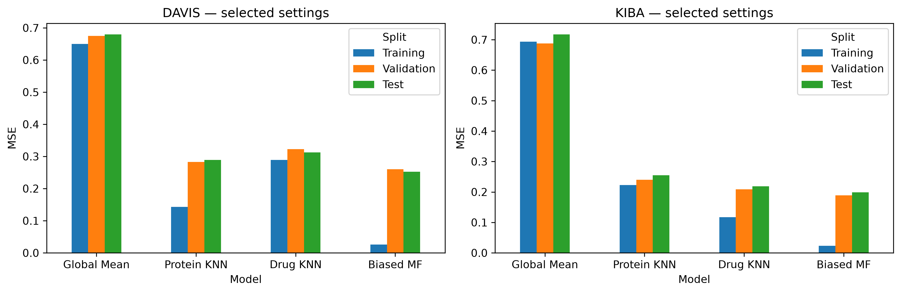
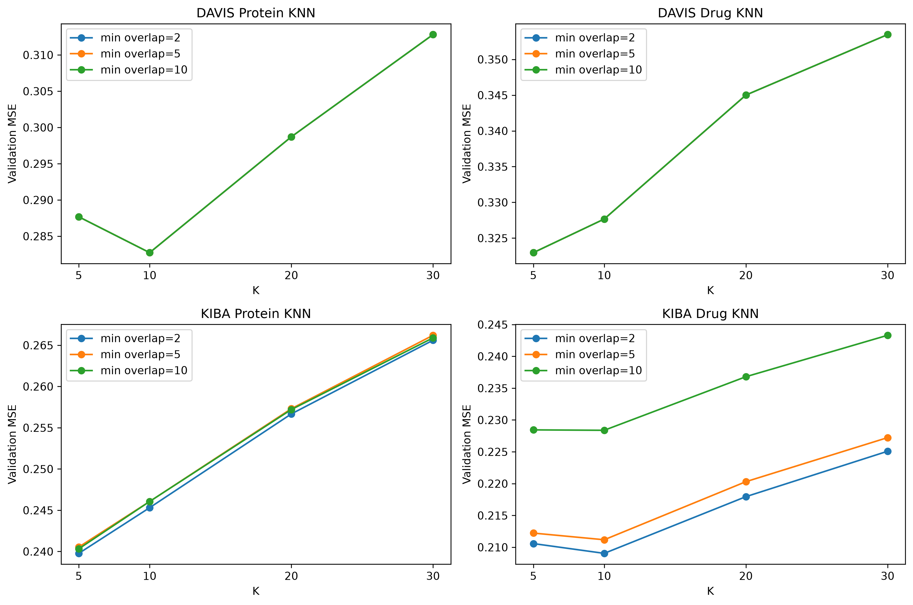
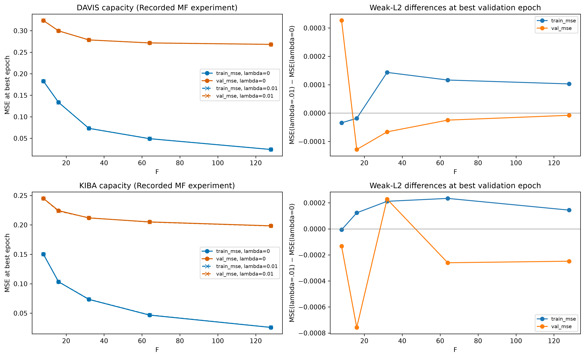
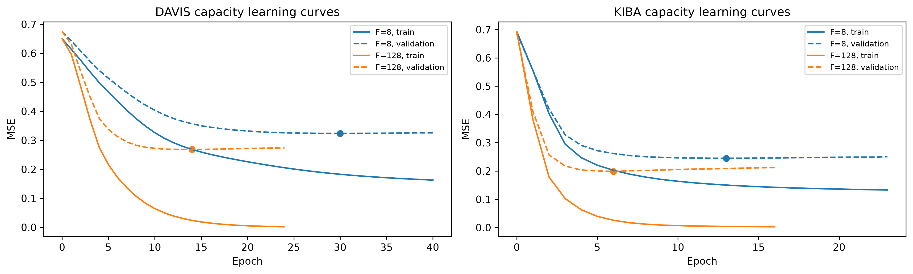
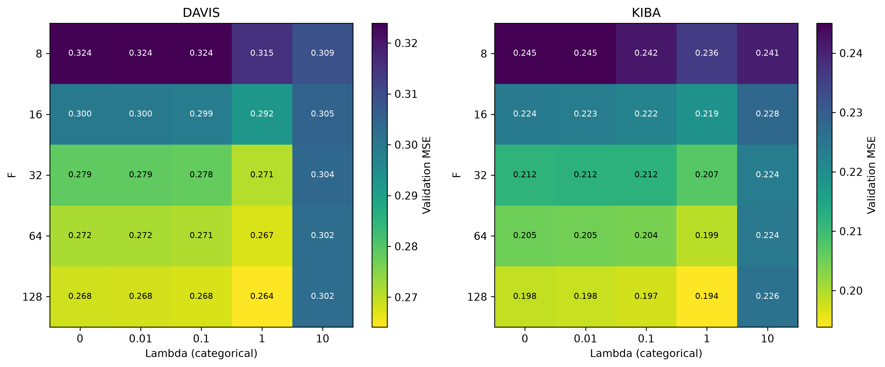
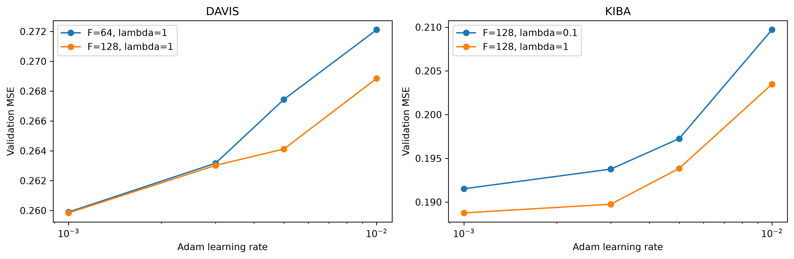
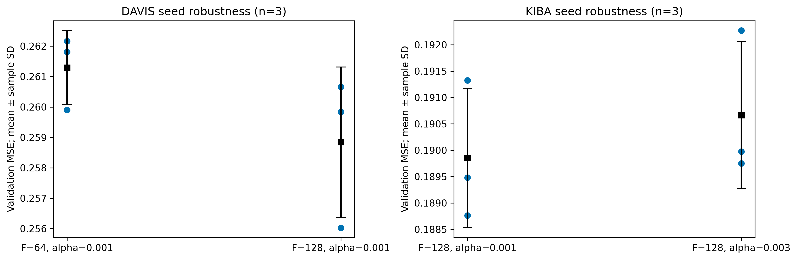

# Task 2 figures for the report

These seven 300-dpi PNGs come from an independently executed
[`task2.ipynb`](../../task2.ipynb), using the pinned dependencies. The final model
comparison uses recomputed checkpoint predictions. The KNN and MF search figures
use the recorded experiment tables and epoch histories embedded in the notebook;
exporting them does not retrain models.

The following captions can be adapted for the report. The complete report has an
eight-page limit covering all three tasks, so use the figures that support the
discussion rather than inserting every image at full size.

## 1. Final model comparison



**Suggested caption:** Training, validation and test MSE for Global Mean, Protein
KNN, Drug KNN and Biased MF on DAVIS and KIBA. All metrics are recomputed from the
saved checkpoints. Hyperparameters and model-family selection use validation
data; test results do not change those choices. MF has the lowest validation and
test MSE in both datasets. DAVIS and KIBA have different score scales, so raw MSE
values should be compared within each dataset.

Use the [published metrics CSV](../train_validation_test_metrics.csv) alongside
this figure for CI, Hit@1, Hit@5 and candidate-restricted Hit@5. The notebook
discloses earlier test exposure; this is not a never-viewed blind holdout.

## 2. KNN validation search



**Suggested caption:** Recorded validation MSE for 48 KNN configurations across
two datasets and two similarity orientations, varying K over {5, 10, 20, 30} and
minimum overlap over {2, 5, 10}, with shrinkage fixed at 10. Training observations
determine similarities and means. Lower validation MSE selects the configuration;
exact ties favor smaller K, then smaller minimum overlap. Overlapping lines,
especially on DAVIS, indicate identical measured results for those thresholds.

## 3. MF capacity and weak regularization — Stage 1



**Suggested caption:** Training and validation MSE at each configuration's
validation-best epoch for F={8, 16, 32, 64, 128}, lambda={0, 0.01}, learning
rate 0.005 and seed 42. The right panels show paired differences,
MSE(lambda=0.01) minus MSE(lambda=0), at each configuration's own best epoch.
Increasing F improves best-validation MSE over the tested range. Weak L2 has
small, inconsistent effects; the expanded difference scale does not imply
statistical significance or an established capacity optimum.

## 4. MF capacity learning curves — Stage 2



**Suggested caption:** Recorded training and validation MSE by epoch for
representative F=8 and F=128 runs with lambda=0, learning rate 0.005 and seed 42.
Solid lines show training MSE, dashed lines show validation MSE, and markers
identify the validation-best epochs. Continued improvement in training error
after validation error begins increasing supports restoring the earlier
checkpoint. These panels show representative histories; the notebook retains
all 20 capacity histories and their diagnostic results.

## 5. MF capacity–regularization interaction — Stage 3



**Suggested caption:** Best-validation MSE for the joint grid of five factor
dimensions and lambda={0, 0.01, 0.1, 1, 10}, using learning rate 0.005, seed 42
and an initial cap of 100 epochs. Each dataset has its own labelled color scale.
The grid motivates selecting F and lambda jointly. Four lambda=10 runs were
still improving at the cap: DAVIS F=8, 16, 32 and KIBA F=8. These cells represent
budget-limited measurements rather than converged estimates.

## 6. MF learning-rate refinement — Stage 4



**Suggested caption:** Recorded validation MSE across Adam learning rates
{0.001, 0.003, 0.005, 0.01} for the two shortlisted F–lambda pairs per dataset.
All runs use seed 42 and validation-based stopping. Learning rate 0.001 gives the
lowest validation MSE in each refined family. The predefined extension rule
replays a capped, recently improving run with a 300-epoch cap; eligible results
include that replay. Lower error does not imply lower training cost: slower
rates can require more optimizer updates.

## 7. MF seed robustness — Stage 5



**Suggested caption:** Validation MSE for seeds 42, 123 and 2026 at the two
shortlisted full configurations per dataset, all using lambda=1. Blue points
show individual seeds; black squares and error bars show the mean and sample
standard deviation. The bars are not confidence intervals. Final configurations
minimize three-seed mean validation MSE, while the handoff checkpoint always uses
seed 42. Three seeds provide limited stability evidence.

## Reproduction and scope

Follow [`task2/README.md`](../../README.md) to Run All. The notebook exports the
same filenames at 300 dpi under:

```text
task2/results/task2_submission/review/
```

The published PNGs are byte-identical to that verified run's exports. Checksums
and execution details are in
[`submission_verification.json`](../../submission_verification.json).
The generated review directory remains Git-ignored. It also contains selected
checkpoint learning curves and fuller regularization/rate diagnostics for
additional analysis.

Case-study tables and ranking metrics still need to accompany the report's
figures. In particular, overall Hit@5 is automatically one for a drug with at
most five measured candidates; include the separately reported restricted
Hit@5 when discussing recommendation quality.
